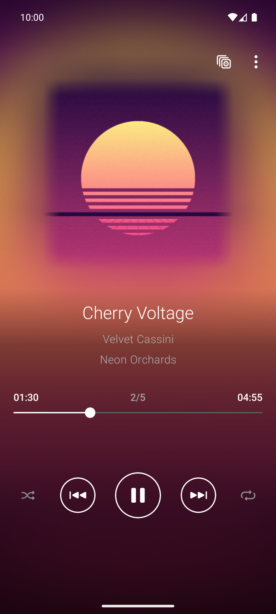
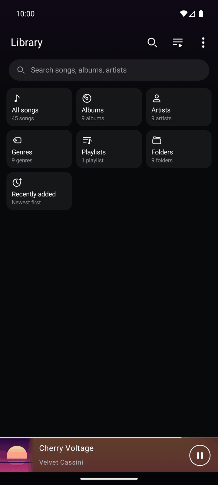
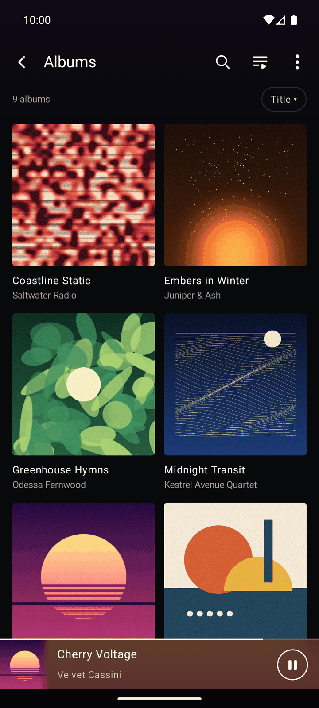
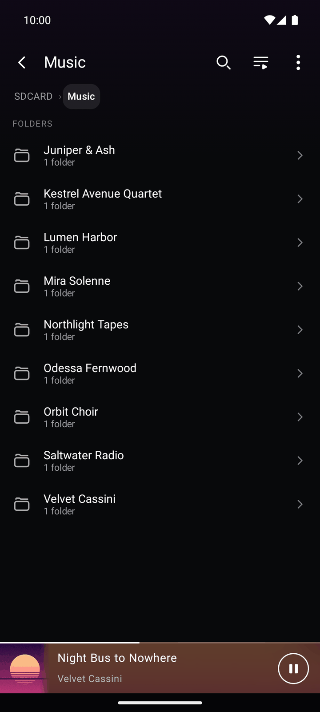
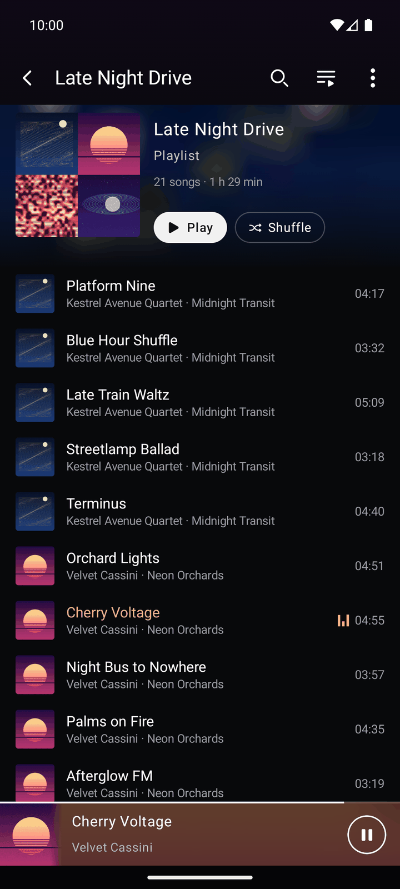
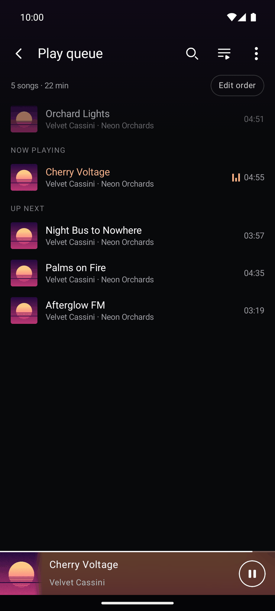
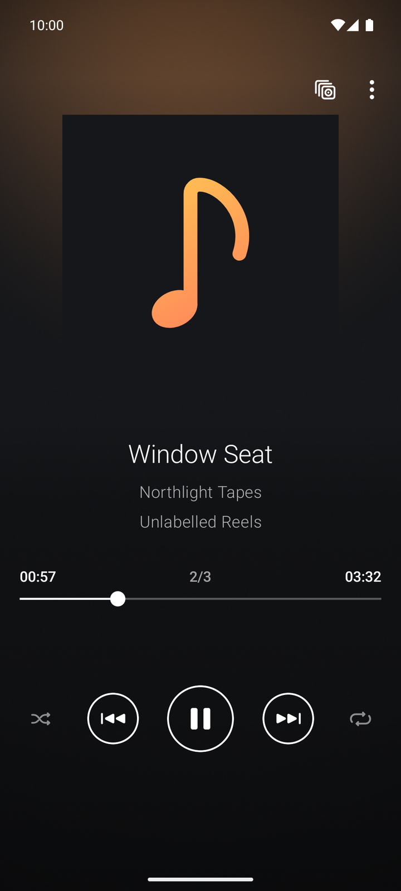
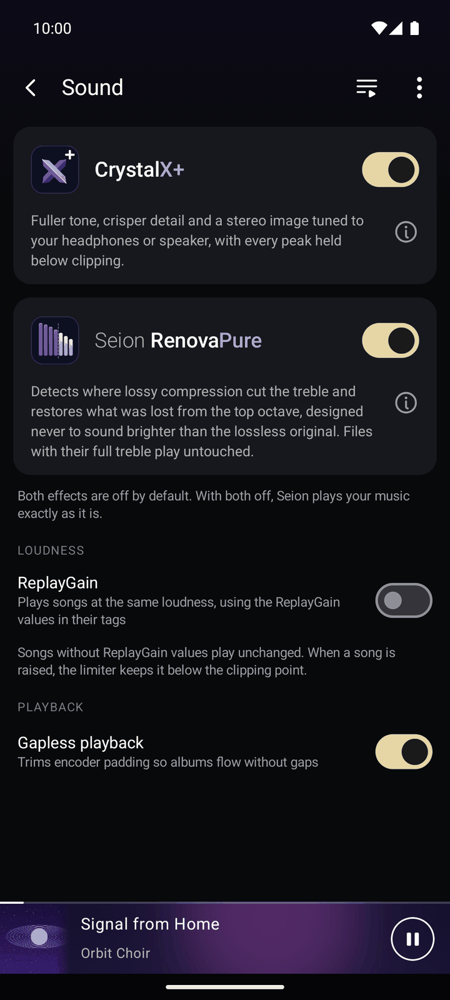
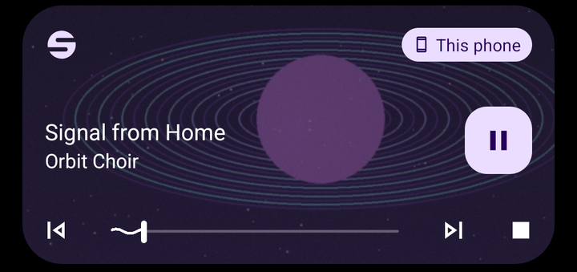

<p align="center">
  
</p>

<h1 align="center">Seion</h1>

<p align="center">
  <sub>清音 · clear sound</sub><br><br>
  <strong>The music player for the files you own.</strong>
</p>

<p align="center">
  
  
</p>

<p align="center">
  <a href="#sound">Sound</a> ·
  <a href="#screenshots">Screenshots</a> ·
  <a href="#privacy">Privacy</a> ·
  <a href="#requirements-and-install">Install</a> ·
  <a href="DEVELOPMENT.md">Development</a> ·
  <a href="CONTRIBUTING.md">Contributing</a>
</p>

Seion plays the music on your phone and memory card, and nothing else. There is no account, no streaming and no
tracking. Point it at your folders and it builds a calm, fast library from your tags, shows every song on a screen
that takes its colours from the cover, and runs your audio through its own engine, untouched unless you ask for more.

The name is the Japanese word 清音 (*seion*), written with the characters for "clear" (清) and "sound" (音).

<p align="center">
  
</p>

## Highlights

- **Now playing, painted by the cover.** The cover's colours spread across the whole screen, blurred and drifting
  slowly while the song plays, and cross-fade from one track to the next.
- **Two in-house sound technologies.** CrystalX+ for tone and stereo, RenovaPure for lossy files. Both are off by
  default, and with both off your music plays bit for bit.
- **Your folders, as they are.** Browse by album, artist, genre or the real folder tree, on internal storage and
  memory cards.
- **Private by design.** No account, no analytics. The only network use is an optional cover lookup that you can
  switch off with one tap.

## Screenshots

<table>
  <tr>
    <td align="center"><br><sub>Library</sub></td>
    <td align="center"><br><sub>Albums</sub></td>
    <td align="center"><br><sub>Folders</sub></td>
  </tr>
  <tr>
    <td align="center"><br><sub>Playlists</sub></td>
    <td align="center"><br><sub>Play queue</sub></td>
    <td align="center"><br><sub>No cover, no empty box</sub></td>
  </tr>
</table>

<sub>All artists, albums and covers in the screenshots are fictional, generated for the demo.</sub>

## Sound

Seion has its own audio engine with two optional effects, side by side on the **Sound** screen (the menu on any
screen, then Sound). Each has a switch and an information button that explains how it works.

<table>
  <tr>
    <td width="50%" valign="top">
      <p align="center"></p>
      <h3 align="center">CrystalX+</h3>
      <p align="center"><strong>Fuller tone, crisper detail and a stereo image tuned to what you are listening on.</strong></p>
      <ul>
        <li><strong>Tonal balance:</strong> gentle bass and treble shelves modelled on the ear's equal-loudness contours, with a dynamic bass control that keeps loud passages from booming.</li>
        <li><strong>Harmonic exciter:</strong> a subtle stage, oversampled 2× to stay clean, adds fine upper harmonics and backs off when the band is already loud.</li>
        <li><strong>Output-aware stereo:</strong> crossfeed on headphones for a more natural image, added width on the phone's speaker, following the active output.</li>
        <li><strong>True-peak limiter:</strong> measures peaks between samples as well as on them, and holds every one below −1 dBTP.</li>
      </ul>
    </td>
    <td width="50%" valign="top">
      <p align="center"></p>
      <h3 align="center">RenovaPure</h3>
      <p align="center"><strong>Brings back the treble that lossy compression cut off.</strong></p>
      <ul>
        <li><strong>Finds the cutoff:</strong> MP3 and AAC encoders discard everything above a certain frequency. RenovaPure reads the spectrum and locates that edge within the first seconds of playback.</li>
        <li><strong>Rebuilds the missing band</strong> from the music just below the cutoff, at most an octave down, following the recording's natural roll-off.</li>
        <li><strong>Never brighter than the original:</strong> the restored band sits slightly below the predicted level, and an onset guard keeps attacks from smearing.</li>
        <li><strong>Leaves full-range files alone:</strong> lossless rips pass through bit for bit.</li>
      </ul>
    </td>
  </tr>
</table>

<p align="center">
  
</p>

### Loudness and gapless playback

- **ReplayGain** (off by default) plays songs at the same loudness from the ReplayGain values in their tags, by album
  or by track, with a pre-amp of −6 to +6 dB. A raised song is kept below clipping by the same limiter.
- **Gapless playback** trims encoder padding, so live albums and DJ mixes flow without a break.
- **Bit-exact when off.** With both effects and ReplayGain off, the engine is a plain delay line: what leaves it is
  exactly what came in.

## Library and folders

- All songs, Albums, Artists, Genres, Playlists, Folders and Recently added, with search by title, artist or album.
- Artists are grouped by album artist, a leading "The" is ignored when sorting, and albums sort by title, artist or
  year.
- The folder browser shows the real folder tree, with breadcrumbs, from internal storage and memory cards. Tap a file
  to play its folder as it is.
- Plays MP3, AAC/M4A, FLAC, WAV, Ogg Vorbis, Opus and ALAC.
- The library updates itself when you open Seion or insert a memory card.
- Covers come from a picture you chose, the art in the file, or an image such as `cover.jpg` in the album folder.
  Albums without art get a dedicated "no cover" tile instead of an empty box.

## Playlists and queue

- Touch and hold any song, album, artist, genre or folder and choose **Add to playlist**. Songs already in the list
  aren't added twice.
- Each playlist has a cover mosaic, Play and Shuffle, and an **Edit order** mode to drag or remove songs, with Undo.
- Playlists are references, never copies: your files stay where they are. Import and export M3U/M3U8 files.
- The play queue shows what played, what is playing and what comes next, in play order even while shuffled, and
  survives a restart.
- Shuffle and repeat remember your choice. Close Seion, even restart the phone, and it reopens where you left off.

## Background playback and controls

<p align="center">
  
</p>

- Music keeps playing with the screen off, with full controls in the notification shade, on the lock screen and from
  headset or Bluetooth buttons.
- Seion pauses when headphones disconnect and gives way to calls and other apps.
- A **sleep timer** (15 to 90 minutes, or the end of the current song) fades the music out, then pauses.
- **Android Auto** and car stereos can browse the queue, albums, artists, playlists and songs, with covers, search and
  voice requests.

## Privacy

- **No accounts and no tracking.** Seion has no analytics and never writes to your music files.
- **Online lookups are optional and limited** to [MusicBrainz](https://musicbrainz.org) and the
  [Cover Art Archive](https://coverartarchive.org). They fill in missing covers, and missing tags on untagged files.
  Only names are sent (album artist and album, or artist, title and length), at most one request per second.
- **Wi-Fi only by default.**
- **One switch turns them off:** Settings, Album art, "Look up missing covers and track info online". With it off,
  Seion makes no network requests at all.

## Requirements and install

- **Android 12 (API 31) or newer.** Portrait only. The interface is in English and Brazilian Portuguese.
- Seion isn't on Google Play: build the APK as described below and install it.
- On first launch Seion asks for **All files access**, which it uses to read your music folders and memory cards.
  On Android 13 and newer it also asks to show notifications, which the media controls need.
- Music folders default to internal `Music/` and the root of every memory card; change them in Settings.

**Good to know:** there is no equalizer, and DSD files and cue sheets aren't supported. On some phones the platform
MP3 decoder drops the first few milliseconds of each file, which can leave a very short gap between gapless MP3
tracks; FLAC, WAV and ALAC are sample-exact.

## Build

You need JDK 17 and the Android SDK; the Gradle wrapper does the rest.

```sh
./gradlew assembleDebug   # app/build/outputs/apk/debug/app-debug.apk, installs as io.github.de1987.seion.debug
make check                # build, unit tests, ktlint and Android lint
```

[DEVELOPMENT.md](DEVELOPMENT.md) covers the architecture, tests, release builds and signing. Contributions are welcome: see
[CONTRIBUTING.md](CONTRIBUTING.md).

### FFmpeg and ALAC

Android has no ALAC decoder, so Seion bundles Jellyfin's prebuilt Media3 FFmpeg decoder
(`org.jellyfin.media3:media3-ffmpeg-decoder`) for ALAC only. That build is GPL-3.0, so an APK that contains it carries
GPL obligations when distributed. Build with `-Pseion.ffmpeg=false` to leave it out; ALAC files are then skipped
with a message. The decoder's source is at
[jellyfin/jellyfin-androidx-media](https://github.com/jellyfin/jellyfin-androidx-media) (tag `v1.9.0+1`, the
version Seion uses), and FFmpeg's at [ffmpeg.org](https://ffmpeg.org).

## License

Copyright (C) 2026 Seion contributors

Seion is free software: you can redistribute it and/or modify it under the terms of the GNU General Public License
as published by the Free Software Foundation, either version 3 of the License, or (at your option) any later
version. It is distributed in the hope that it will be useful, but without any warranty; see [LICENSE](LICENSE) for
the full text.

The GPL was chosen because the bundled FFmpeg decoder is GPL-3.0. The other components are under the Apache 2.0,
MIT and BSD 3-Clause licences, the Public Suffix List bundled by OkHttp under the MPL 2.0, and the Roboto fonts under
the SIL Open Font License, all of which can be combined with it. Each is listed with its full licence text under
Settings, Open-source licenses.
